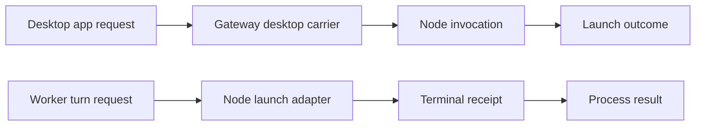

# openclaw/openclaw pull request #161659: refactor(worker-transport): remove dead code and helper slop in worker transport

This file quotes a source as evidence for the reduce skill. It is not an instruction to the reader.

- Author: steipete
- Date: 2026-09-30
- Original location: https://github.com/openclaw/openclaw/pull/161659
- Copied: 2026-11-20, from the pull request, its comments, its reviews, and its diff, from the GitHub API

## Text
## What Problem This Solves

Removes 14 net production lines of redundant worker transport code in a maintainer-requested cleanup.

## User Impact

No user-visible change. Error text, receipt results, authority checks, cancellation, ordering, and lifecycle behavior remain unchanged.

## Why This Change Was Made

The desktop launch path constructs its error directly, preserving message trimming and the fallback. The receipt-to-spawn-result mapper now accepts the terminal receipt type already guaranteed by its sole production caller's launcher, removing an unreachable nonterminal guard.

Main `0a0a2e0489026b2e73d139383e7b60515fcaf7f3` was merged because `79fded8bf552e6d683859a14d3ef789d70fc0933` changed the failing cron CLI / worker-turn-admission owner. Main already contains this PR's required-helper inline, so `worker-turn-admission.ts` now exactly matches main and is absent from the remaining diff. The branch was merged without rebasing or force-pushing.

## Evidence

The remaining change spans `node-desktop-carrier.ts` and `node-launch-adapter.ts`: **25 production lines removed, 11 added, 14 net removed**. No tests were added or changed.

- Co-located desktop and launch-adapter suites plus `node-worker-tunnel.lifecycle.test.ts`: **78 tests passed across 3 files**, through `node scripts/run-vitest.mjs <three files> --maxWorkers=1`; wrapper wall **202.07s**, including isolated worker compilation and cleanup.
- `pnpm tsgo:core`: passed, **24.36s**.
- Type-aware oxlint with the core tsconfig: passed, **20.99s**.
- Installed oxfmt on both changed files: passed, **0.71s**.
- Staged/unstaged `git diff --check`: passed.
- Fresh independent Codex P0–P2 review of the full remaining delta: **scoped-clean**, no actionable findings.

Source review confirms the only production mapper caller awaits `createNodeWorkerLaunchAdapter().launch()`, which parses and validates identity and only returns terminal receipts. Its cancellation path also waits for terminal settlement. The desktop inline preserves the existing error construction exactly.

Historical CI on the prior head (`36674809147`, job `109757700366`) timed out in `claude-cli/read`, followed by fixture interference. The owner change above justified this integration; no passing repair is inferred from that history. The new head must satisfy normal native CI/review gates. If that changed-files lane selects the same case and it times out again, landing stops without a CI bypass.

## Current CI blocker

Run `36689466015`, attempt 1, on head `7745effd839d26863d8480c1888715841523c808` completed cancelled. Job `109803394744` (`checks-node-changed-compact-large-7-1`) failed `session-activity-summaries.test.ts > readmits a relocated store and fences a delayed result from its previous owner`: the relocated summary still covered two messages rather than three when the default one-second `vi.waitFor` expired. Aggregate gate job `109806567747` failed.

The complete test file passed in its original case order locally: **23 tests, 69.93s wrapper**, including the relocation case (1214ms overall). That passing replay is not a fix. The fixture prewarms the original store, while relocation requires new database admission/read work and a worker-backed commit; the CI trace does not prove why completion was late or absent. The test and relevant owners are unchanged by this PR and match the tested and inspected current main; no newer owning repair was found. No timeout or assertion was changed, no CI rerun was requested, and no inherited-failure waiver is claimed. Native preparation is complete, but required CI currently blocks merge admission.


## Change

2 commits, 2 files, +11 -25. Merged: no.

## Comment by clawsweeper[bot], 2026-09-30

<!-- clawsweeper-pr-ack:opened item=161659 -->
🦞👀
ClawSweeper picked this up.

Pull request received. I will update this pull request when review starts.

<!-- clawsweeper-review-progress:start -->
### ClawSweeper review complete

ClawSweeper finished reviewing this revision. The review result is being finalized.

[View the workflow run](https://github.com/openclaw/clawsweeper/actions/runs/36691210552).
<!-- clawsweeper-review-progress:end -->

## Comment by clawsweeper[bot], 2026-09-30

Codex review: needs changes before merge. _Reviewed September 30, 2026, 4:44 AM ET / 08:44 UTC (Revision 4)._

# ClawSweeper review

## What this changes

The branch inlines a desktop launch error and simplifies how a completed node worker receipt becomes a process result.

## Merge readiness

⛔ **Needs changes before merge - 1 item remains**

Keep this PR open. Current main still contains the two redundant paths, and source review found no defect in the introduced cleanup.

**Priority:** P3
**Reviewed head:** `7745effd839d26863d8480c1888715841523c808`

## Review scores

| Measure | Result | What it means |
|---|---|---|
| **Overall readiness** | 🐚 platinum hermit **(4/6)** | The narrow patch and its source contract are convincing, with focused validation reported and no introduced defect found. |
| **Proof confidence** | 🐚 platinum hermit **(4/6)** | Not applicable: The Repository State classifies the author as MEMBER, so the external-contributor proof gate does not apply. Focused tests are reported, but no real node transport trace is presented; no stored-data contract changes. |
| **Patch quality** | 🐚 platinum hermit **(4/6)** | No actionable review findings were identified. |

## Verification

| Check | Result | Evidence |
|---|---|---|
| **Real behavior** | Not applicable | Not applicable: The Repository State classifies the author as MEMBER, so the external-contributor proof gate does not apply. Focused tests are reported, but no real node transport trace is presented; no stored-data contract changes. |
| **Evidence reviewed** | 5 items | Introduced cleanup: The pinned base-to-head diff inlines the existing trimmed error message and narrows the receipt mapper's input to terminal receipts.<br>Terminal receipt boundary: The launch adapter validates receipt identity and returns only terminal receipts; its cancellation path also waits for terminal settlement. The sole production mapper call awaits that adapter.<br>Current-main comparison: Current main retains the helper and nonterminal guard; its two affected files match the pinned base, so this cleanup has not landed there. |
| **Findings** | None | None. |
| **Security** | None | None. |

## How this fits together

The Gateway sends desktop launch and worker turn requests to a paired node. These paths interpret the node's response for desktop callers and agent execution.



## Before merge

- [ ] **Complete next step (P2)** - Establish the disposition of the failed relocated-store check and satisfy the native CI gate for this head.


<details>
<summary><strong>Agent review details</strong></summary>

### Security

None.

### PR surface

Source -14. Total -14 across 2 files.

<details>
<summary>View PR surface stats</summary>

| Area | Files | Added | Removed | Net |
|---|---:|---:|---:|---:|
| Source | 2 | 11 | 25 | -14 |
| Tests | 0 | 0 | 0 | 0 |
| Docs | 0 | 0 | 0 | 0 |
| Config | 0 | 0 | 0 | 0 |
| Generated | 0 | 0 | 0 | 0 |
| Other | 0 | 0 | 0 | 0 |
| **Total** | **2** | **11** | **25** | **-14** |

</details>

### Review metrics

| Metric | Value | Why it matters |
|---|---|---|
| **Receipt mapper callers** | 1 production caller | The caller awaits the adapter's terminal receipt contract, which makes the removed guard redundant on the production path. |

### Technical review

Best possible solution:

Land the focused simplification once the native CI gate has an established disposition for this head.

Do we have a high-confidence way to reproduce the issue?

Not applicable: this PR proposes a cleanup, not a reported defect; the affected call path is identifiable in source.

Is this the best way to solve the issue?

Yes. The sole production caller already receives a terminal receipt, and the desktop error retains its existing message behavior.

AGENTS.md: found and applied where relevant.

Codex review notes: model internal, reasoning high; reviewed against [754453157b15](https://github.com/openclaw/openclaw/commit/754453157b15c02d535670cf2ddf4df4639222fc).

### Labels

Label changes:

No label changes.

Label justifications:

- `P3`: This is a small internal cleanup with no claimed user-visible behavior change.
- `rating: 🐚 platinum hermit`: Overall readiness is 🐚 platinum hermit; proof is 🐚 platinum hermit and patch quality is 🐚 platinum hermit.
- `status: 👀 ready for maintainer look`: ClawSweeper has no concrete contributor-facing blocker left for this PR. Not applicable: The Repository State classifies the author as MEMBER, so the external-contributor proof gate does not apply. Focused tests are reported, but no real node transport trace is presented; no stored-data contract changes.

### Evidence

What I checked:

- **Introduced cleanup:** The pinned base-to-head diff inlines the existing trimmed error message and narrows the receipt mapper's input to terminal receipts. ([`src/gateway/worker-environments/node-launch-adapter.ts:45`](https://github.com/openclaw/openclaw/blob/7745effd839d26863d8480c1888715841523c808/src/gateway/worker-environments/node-launch-adapter.ts#L45), [7745effd839d](https://github.com/openclaw/openclaw/commit/7745effd839d26863d8480c1888715841523c808))
- **Terminal receipt boundary:** The launch adapter validates receipt identity and returns only terminal receipts; its cancellation path also waits for terminal settlement. The sole production mapper call awaits that adapter. ([`src/gateway/worker-environments/node-launch-adapter.ts:480`](https://github.com/openclaw/openclaw/blob/7745effd839d26863d8480c1888715841523c808/src/gateway/worker-environments/node-launch-adapter.ts#L480), [7745effd839d](https://github.com/openclaw/openclaw/commit/7745effd839d26863d8480c1888715841523c808))
- **Current-main comparison:** Current main retains the helper and nonterminal guard; its two affected files match the pinned base, so this cleanup has not landed there. ([`src/gateway/worker-environments/node-desktop-carrier.ts:72`](https://github.com/openclaw/openclaw/blob/754453157b15c02d535670cf2ddf4df4639222fc/src/gateway/worker-environments/node-desktop-carrier.ts#L72), [754453157b15](https://github.com/openclaw/openclaw/commit/754453157b15c02d535670cf2ddf4df4639222fc))
- **Focused validation and CI state:** The PR body reports 78 focused tests and core type and lint checks passing. It also records a failed, unchanged relocated-store test in the cancelled native CI run; the passing local replay does not establish its cause. ([`src/gateway/session-activity-summaries.test.ts:948`](https://github.com/openclaw/openclaw/blob/7745effd839d26863d8480c1888715841523c808/src/gateway/session-activity-summaries.test.ts#L948), [7745effd839d](https://github.com/openclaw/openclaw/commit/7745effd839d26863d8480c1888715841523c808))
- **Area history:** Current-main history shows repeated prior work on both affected paths by Peter Steinberger. Missing historical blobs prevented source-line introduction verification, so this is routing evidence only. ([`src/gateway/worker-environments/node-launch-adapter.ts`](https://github.com/openclaw/openclaw/blob/754453157b15c02d535670cf2ddf4df4639222fc/src/gateway/worker-environments/node-launch-adapter.ts), [754453157b15](https://github.com/openclaw/openclaw/commit/754453157b15c02d535670cf2ddf4df4639222fc))

Likely related people:

- **steipete:** Suggested for follow-up; no historical authorship or introduction is verified. (role: unverified routing candidate; confidence: low)

### Rating scale

| Score | Internal tier | Crab rank | Meaning |
|---:|:---:|---|---|
| **6/6** | S | 🦀 challenger crab | Exceptional readiness |
| **5/6** | A | 🦞 diamond lobster | Very strong readiness |
| **4/6** | B | 🐚 platinum hermit | Good normal PR; ordinary maintainer review |
| **3/6** | C | 🦐 gold shrimp | Useful, but confidence is limited |
| **2/6** | D | 🦪 silver shellfish | Proof or implementation needs work |
| **1/6** | F | 🧂 unranked krab | Not merge-ready |
| N/A | NA | 🌊 off-meta tidepool | Rating does not apply |

Overall follows the weaker of proof and patch quality.
Shiny media proof means a screenshot, video, or linked artifact directly shows the changed behavior. Runtime, network, CSP, and security claims still need visible diagnostics.

### Workflow

- ClawSweeper keeps one durable marker-backed review comment per issue or PR.
- Re-runs edit this comment so the latest verdict, findings, and automation markers stay together instead of adding duplicate bot comments.
- A fresh review can be triggered by eligible `@clawsweeper re-review` comments, exact-item GitHub events, scheduled/background review runs, or manual workflow dispatch.
- PR/issue authors and users with repository write access can comment `@clawsweeper re-review` or `@clawsweeper re-run` on an open PR or issue to request a fresh review only.
- Maintainers can also comment `@clawsweeper review` to request a fresh review only.
- Fresh-review commands do not start repair, autofix, rebase, CI repair, or automerge.
- Maintainer-only repair and merge flows require explicit commands such as `@clawsweeper autofix`, `@clawsweeper automerge`, `@clawsweeper fix ci`, or `@clawsweeper address review`.
- Maintainers can comment `@clawsweeper explain` to ask for more context, or `@clawsweeper stop` to stop active automation.

### History

<details>
<summary>Review history (3 earlier review cycles)</summary>

<!-- clawsweeper-review-history v=1 total=3 -->
- reviewed 2026-09-30T05:48:20.889Z sha b2317909553caa7e03101548c6030bc675f79ee5 :: blocked before merge. :: none
- reviewed 2026-09-30T08:29:38.929Z sha 7745effd839d26863d8480c1888715841523c808 :: needs maintainer review before merge. :: none
- reviewed 2026-09-30T08:36:29.806Z sha 7745effd839d26863d8480c1888715841523c808 :: needs maintainer review before merge. :: none

</details>

</details>

<!-- clawsweeper-verdict:needs-human item=161659 sha=7745effd839d26863d8480c1888715841523c808 confidence=high updated_at=2026-09-30T08:41:41Z reviewed_at=2026-09-30T08:44:43.684Z lease_owner=github-run-36691210552-1 lease_comment_id=5907512585 source_revision=a9c8101b4b7f25b82b24fbac593983be918730543de665f963e70ee0d8c8cf20 live_verification=absent -->
<!-- clawsweeper-review-state:needs-changes item=161659 sha=7745effd839d26863d8480c1888715841523c808 v=1 -->

<!-- clawsweeper-review-version item=161659 reviewed_at=2026-09-30T08:44:43.684Z sha=7745effd839d26863d8480c1888715841523c808 source_revision=a9c8101b4b7f25b82b24fbac593983be918730543de665f963e70ee0d8c8cf20 lease_owner=github-run-36691210552-1 lease_comment_id=5907512585 v=1 -->

<!-- clawsweeper-review item=161659 -->

## Comment by roboclaw-bot, 2026-10-16

Closing as superseded after comparing both code hunks with current main. The terminal-only receipt mapping is already present via #165288 (bd64d93ff1a), and the desktop error helper is already inlined via #165341 (ee122ba9471). No unique behavior or tests remain in this PR.

<!-- peter-aged-pr-cleanup-20261016 -->

## Diff

````diff
diff --git a/src/gateway/worker-environments/node-desktop-carrier.ts b/src/gateway/worker-environments/node-desktop-carrier.ts
index b053d3f512831..728b250a73671 100644
--- a/src/gateway/worker-environments/node-desktop-carrier.ts
+++ b/src/gateway/worker-environments/node-desktop-carrier.ts
@@ -68,18 +68,12 @@ function isBindingCurrent(
   );
 }
 
-function invocationError(
-  result: Awaited<ReturnType<NodeWorkerSupervisorTransport["invoke"]>>,
-): Error {
-  const message = result.error?.message?.trim();
-  return new Error(message || "worker node desktop stream closed before attachment");
-}
-
 function requireLaunchReady(
   result: Awaited<ReturnType<NodeWorkerSupervisorTransport["invoke"]>>,
 ): void {
   if (!result.ok) {
-    throw invocationError(result);
+    const message = result.error?.message?.trim();
+    throw new Error(message || "worker node desktop stream closed before attachment");
   }
   let payload: unknown;
   try {
diff --git a/src/gateway/worker-environments/node-launch-adapter.ts b/src/gateway/worker-environments/node-launch-adapter.ts
index 3494d9be3616f..4c63946231108 100644
--- a/src/gateway/worker-environments/node-launch-adapter.ts
+++ b/src/gateway/worker-environments/node-launch-adapter.ts
@@ -43,24 +43,16 @@ import { WorkerRunnerCapacityError, WorkerRunnerUnavailableError } from "./tunne
 import { boundedWorkerError } from "./worker-error.js";
 
 export function nodeWorkerSpawnResultFromReceipt(
-  receipt: NodeWorkerSupervisorReceipt,
+  receipt: TerminalNodeWorkerSupervisorReceipt,
 ): SpawnResult {
-  if (
-    receipt.state === "completed" ||
-    receipt.state === "failed" ||
-    receipt.state === "interrupted" ||
-    receipt.state === "cancelled"
-  ) {
-    return {
-      stdout: receipt.state === "completed" ? receipt.resultJson : "",
-      stderr: receipt.state === "completed" ? "" : receipt.errorText,
-      code: receipt.state === "completed" ? 0 : 1,
-      signal: null,
-      killed: receipt.state === "cancelled" || receipt.state === "interrupted",
-      termination: "exit",
-    };
-  }
-  throw new Error("node worker launch returned without a terminal receipt");
+  return {
+    stdout: receipt.state === "completed" ? receipt.resultJson : "",
+    stderr: receipt.state === "completed" ? "" : receipt.errorText,
+    code: receipt.state === "completed" ? 0 : 1,
+    signal: null,
+    killed: receipt.state === "cancelled" || receipt.state === "interrupted",
+    termination: "exit",
+  };
 }
 
 const DEFAULT_RPC_TIMEOUT_MS = 30_000;

````
